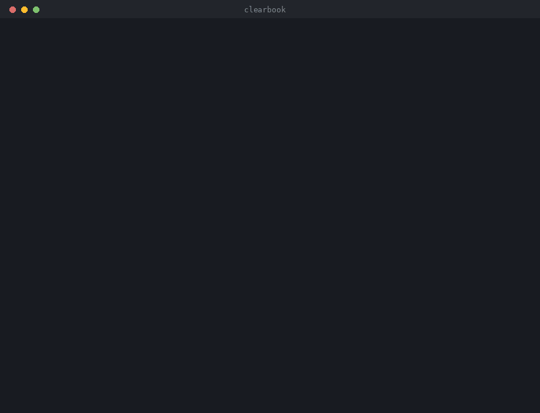
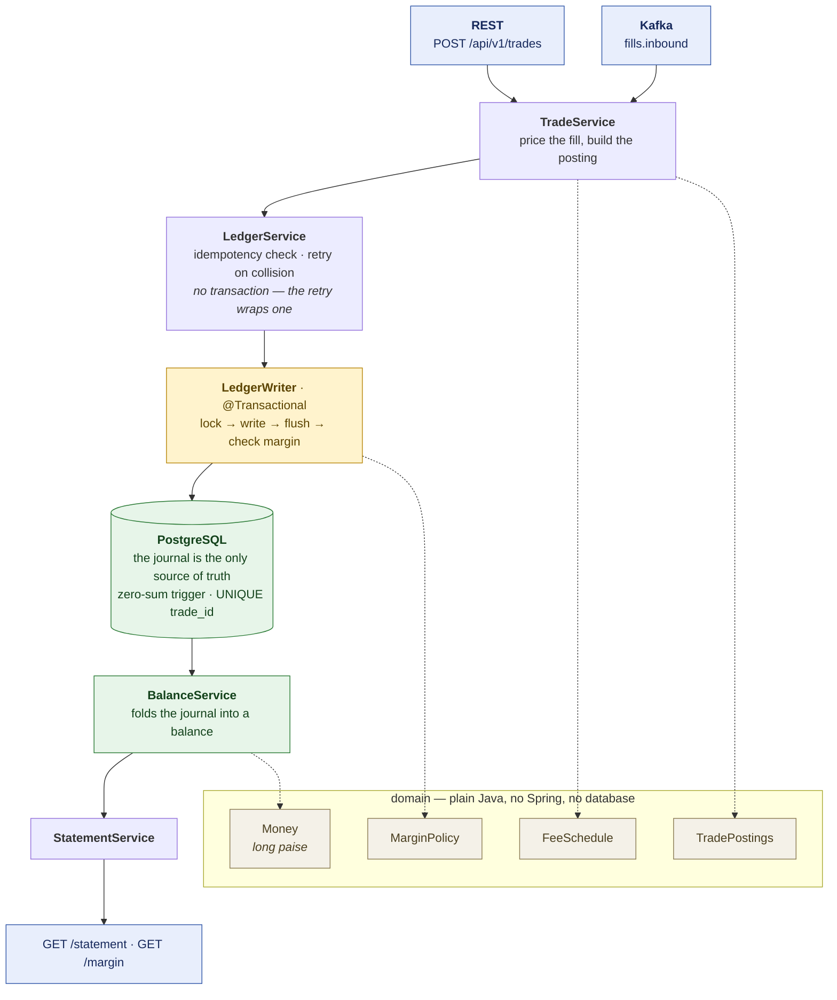
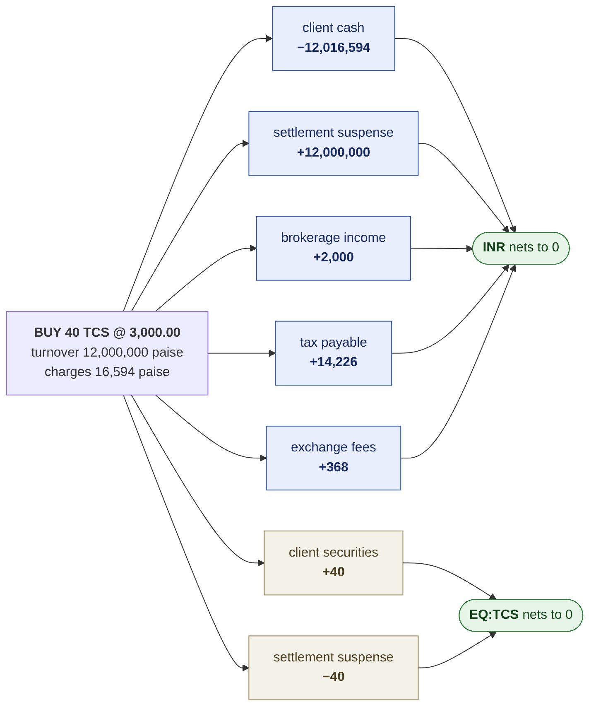
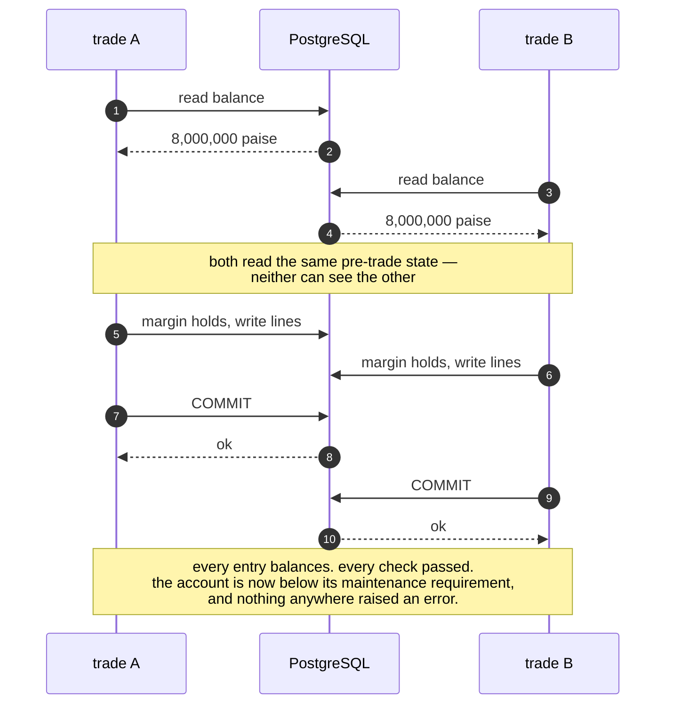
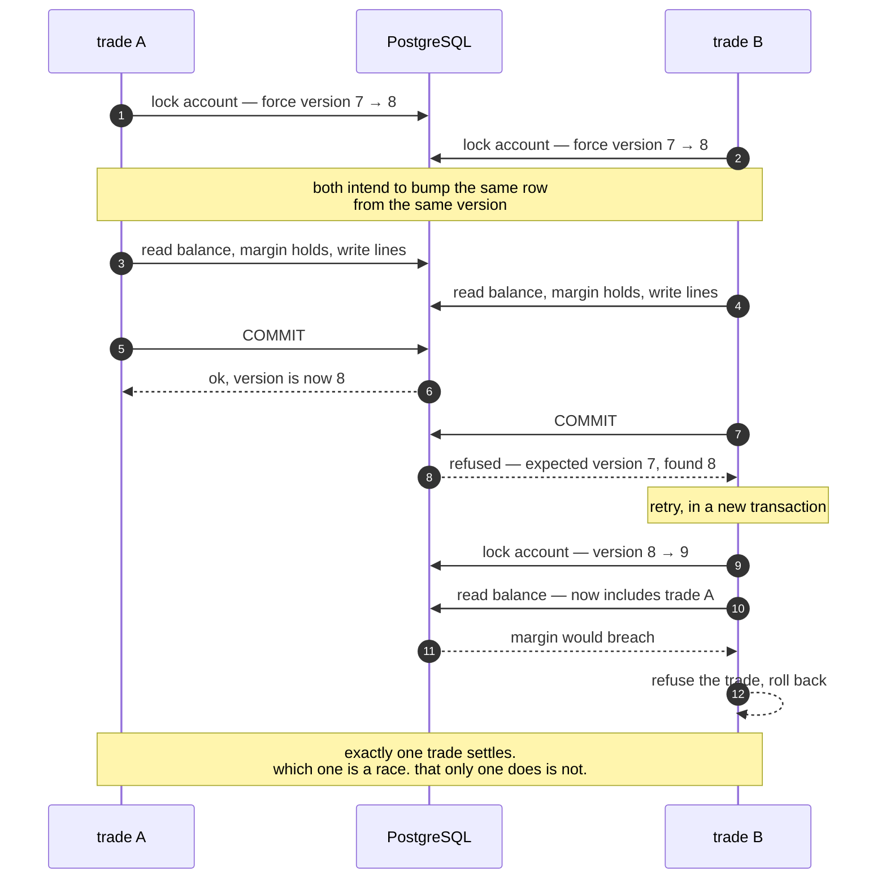
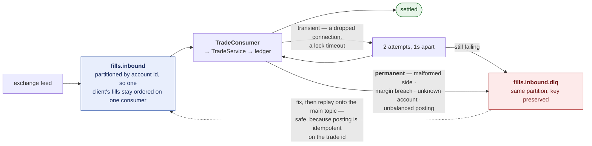

# clearbook

A double-entry trade settlement and margin ledger. Fills arrive on a Kafka
topic or over HTTP, post as balanced journal entries, and every balance is
derived from that journal rather than stored beside it.



*Both scenes are real output: `./tools/demo-ledger.sh` walks two trades through
a live PostgreSQL, and `./tools/verify-schema.sh` checks the DDL's invariants.
Neither needs Java, Maven or Docker.*

```
$ mvn test          # money, fees, postings — no database, no Docker
$ mvn verify        # the same, plus real PostgreSQL and Kafka
$ ./tools/verify-schema.sh     # the database's own invariants, no Java at all
  19 passed, 0 failed
```

**[Architecture and diagrams](docs/ARCHITECTURE.md)** ·
**[Worked examples](docs/examples.md)** — every figure computed by running the
domain code, not written by hand.

---

## How it fits together



The domain — `Money`, `FeeSchedule`, `TradePostings`, `MarginPolicy` — is plain
Java with no Spring and no database, because the arithmetic it carries is the
part most worth testing and it tests far better as a value object than as a
bean. `LedgerService` and `LedgerWriter` are separate beans because a retry has
to wrap a transaction rather than sit inside one; the reasoning is in
[the architecture notes](docs/ARCHITECTURE.md).

---

## The three decisions

Everything else in this repository follows from these.

### 1. Balances are derived, never stored

There is no `balance` column. An account's balance is the sum of its journal
lines:

```java
balance(account, asset) = Σ amount WHERE account_id = ? AND asset = ?
```

Storing a balance means maintaining two representations of the same fact, and
the day they disagree is the day nobody can say which one is right. Deriving
it means a statement and the balance it closes on cannot disagree — the
movements *are* the balance. `LedgerPostingIT.statementReconciles` asserts
exactly that.

The cost is that the naive version is O(history) on the critical path of every
margin check. `balance_checkpoint` fixes that, and is carefully *not* a second
source of truth: it caches a prefix of the same fold, and
`BalanceCheckpointIT` deletes every checkpoint mid-test and requires every
answer to be unchanged.

### 2. An entry balances per asset, not overall

A trade moves rupees and shares at the same moment, and those cannot sum
together into anything meaningful. So the zero-sum rule is scoped to
`(entry, asset)`:



Enforced by a `DEFERRABLE INITIALLY DEFERRED` constraint trigger in
PostgreSQL, so it fires at COMMIT on the finished entry rather than part-way
through inserting its lines — and so that no code path, including one nobody
has written yet, can post an unbalanced entry. The domain checks it too, for a
diagnosable error at the point the lines were built; the database check is the
one that cannot be bypassed.

### 3. The margin check and the write are one unit

This is the part worth reading the code for.

Two trades arrive for the same account at the same moment. Each reads the
balance, computes post-trade margin, finds it fine, and commits. Individually
both were correct. Together they breach the maintenance requirement — and the
ledger balances perfectly while it happens, so nothing raises an error and
nothing looks wrong until somebody reconciles.



That is **write skew**, and no amount of per-trade validation finds it, because
each trade *was* valid when it was checked. The only fix is to make the two
transactions conflict.



Every posting takes an `OPTIMISTIC_FORCE_INCREMENT` on each account it touches,
so the second one fails its version check, retries, re-reads the balance, and
this time sees the first trade.
`ConcurrentSettlementIT.writeSkewCannotBreachMargin` releases both from a latch
and asserts exactly one survives.

The force-increment has to be explicit, incidentally: the account row holds no
balance to dirty, so without it Hibernate would see a clean entity, write
nothing, and the two transactions would never collide at all.

---

## Idempotency

A fill can arrive more than once — Kafka redelivers a record whose offset
never committed, a client retries after a timeout, an operator replays a
dead-letter. It must post exactly once.

```
journal_entry.trade_id  TEXT UNIQUE
```

A `UNIQUE` constraint, not an application-level "have I seen this?" check.
The check is still there, because it turns the common case into one cheap read
instead of a failed insert — but it cannot be the guarantee. Every concurrent
caller can pass that check before any of them inserts, which is precisely the
situation redelivery creates. `ConcurrentSettlementIT.concurrentRedeliveryPostsOnce`
fires the same trade from twenty threads and asserts one entry and one charge.

A duplicate submission returns **200 with `alreadyPosted: true`**, not 409. A
client asking for the same thing twice should get the same answer twice;
returning an error pushes the deduplication problem back onto every caller,
which is the problem an idempotency key exists to remove.

---

## Money

`long` paise, everywhere. Never `double`, and never a JSON number on the wire —
amounts cross the API as decimal strings, because a consumer parsing
`1234.56` into a binary float has reintroduced the error the ledger exists to
prevent.

Fees round **half-even**, per component, and the charged total is defined as
the sum of those rounded components. Half-up would round every terminal 5
upward, so across a day of fee calculations the broker systematically collects
a fraction of a paisa more than the stated rate; half-even breaks ties to the
even neighbour and the bias cancels. Defining the total as the sum of the
parts is what makes a trade entry balance exactly — the client is debited
precisely what the fee accounts are credited, with no residue needing a home.

The reference scenario in `GoldenScenarioTest` was worked out by hand before
any of this code existed, and deliberately includes a GST figure of exactly
184.50 paise so that a true half-even tie is exercised rather than only
rounding down.

---

## Running it

```bash
# A database to point at
docker run -d --name clearbook-db -p 5432:5432 \
  -e POSTGRES_PASSWORD=postgres -e POSTGRES_DB=clearbook postgres:16-alpine

mvn spring-boot:run
```

Browsable API docs at **`http://localhost:8080/swagger-ui.html`**, health at
`/actuator/health`. [`docs/examples.md`](docs/examples.md) has the full set of
request and response pairs, with every figure computed by running the domain
code.

```bash
curl -s localhost:8080/api/v1/trades -H 'content-type: application/json' -d '{
  "tradeId": "T-1", "clientId": "ARY", "symbol": "TCS",
  "side": "BUY", "quantity": 40, "price": "3000.00",
  "businessDate": "2026-03-02"
}' | jq
```

```jsonc
{
  "tradeId": "T-1",
  "entryId": 12,
  "alreadyPosted": false,
  "attempts": 1,
  "charges": {
    "brokerage": "20.00",            // 0.03% of turnover, capped
    "securities transaction tax": "120.00",
    "exchange transaction": "3.56",  // 356.40 paise, rounded half-even
    "regulator turnover": "0.12",
    "stamp duty": "18.00",           // purchases only
    "GST": "4.26"                    // 18% of already-rounded components
  },
  "totalCharges": "165.94",
  "margin": { "equity": "502290.97", "requirement": "18300.00", "solvent": true }
}
```

| | |
|---|---|
| `POST /api/v1/trades` | submit a fill; 201 new, 200 already posted |
| `GET /api/v1/accounts/{id}/statement` | closing position and every movement behind it |
| `GET /api/v1/accounts/{id}/margin?asOf=` | equity against requirement |

Fills also arrive on the `fills.inbound` Kafka topic.



Partitioned by account, so one client's fills stay ordered on one consumer.
Anything that cannot be settled goes straight to the dead-letter topic on the
first failure rather than being retried — retrying a permanently broken record
stalls every good record behind it on that partition, which is how one poison
message takes a settlement system down.

---

## Testing

| tier | needs | what it establishes |
|---|---|---|
| `mvn test` | a JDK | money, fees, rounding, posting invariants |
| `mvn verify` | Docker | the database's invariants, the race, idempotency, the API, Kafka |
| `./tools/verify-schema.sh` | a PostgreSQL | the DDL alone, no Java involved |
| `./tools/demo-ledger.sh` | a PostgreSQL | the reference scenario end to end in SQL |

The split matters: the properties under test are properties of PostgreSQL
specifically — a deferred constraint trigger, a UNIQUE index closing a race,
two transactions genuinely colliding on a version check. H2 implements none of
them and a mock implements fewer, so a suite built on either would pass while
production refused every posting. But requiring Docker to run *any* test would
mean nobody can check the arithmetic on a laptop without it, hence the tier
that needs neither.

---

## Rates are configuration, not constants

The fee and margin rates in `application.yml` are **illustrative**, in the
shape of Indian equity delivery charges. They are not a statement of current
statutory rates. STT, stamp duty, exchange transaction charges, the regulator
turnover fee and GST are all set by regulation and all change; they live in
configuration so a rate change is a configuration change rather than a code
change, a release, and a chance to get one of them wrong.

---

## What this does not do

- **Equity cash segment, single currency, T+1 only.** No derivatives, no FX,
  no multi-currency netting.
- **Flat maintenance margin**, not SPAN or portfolio margin. Netting
  offsetting risk across a portfolio is the right answer for a real clearing
  member and would be most of the project; it would also do nothing about the
  race, which is where the interesting failure actually lives.
- **No settlement cycle yet.** Positions land in a suspense account and stay
  there; the T+1 job that moves them to settled is the next piece.
- **No corporate actions.** Dividends and splits are large and orthogonal.
- **Pro-rata block allocation is unimplemented**, which is why
  `ROUNDING_RESIDUE` exists as an account kind and currently never receives a
  posting — allocating one fill across several client accounts is the case
  that genuinely produces a residue.
- **One PostgreSQL, no sharding**, and mark prices are loaded rather than
  streamed.

## Licence

MIT.
