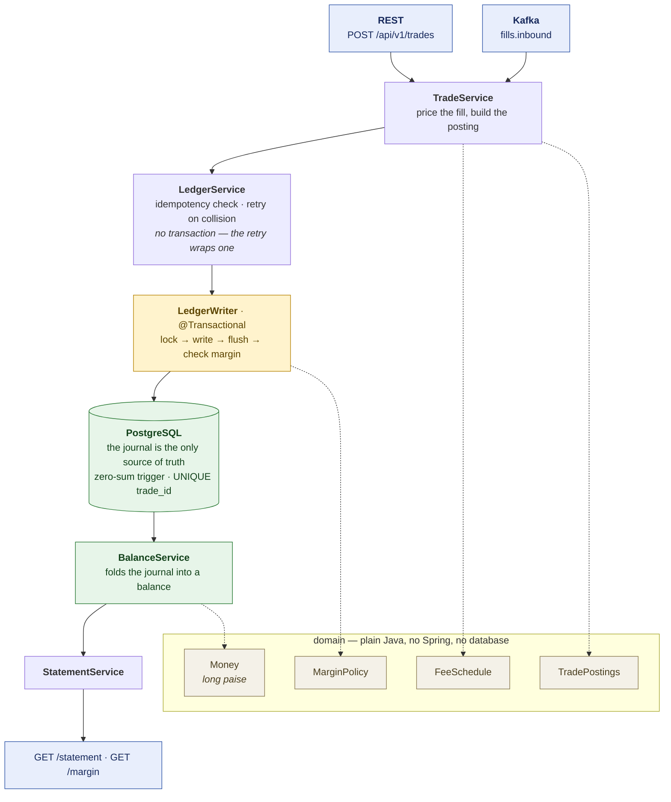
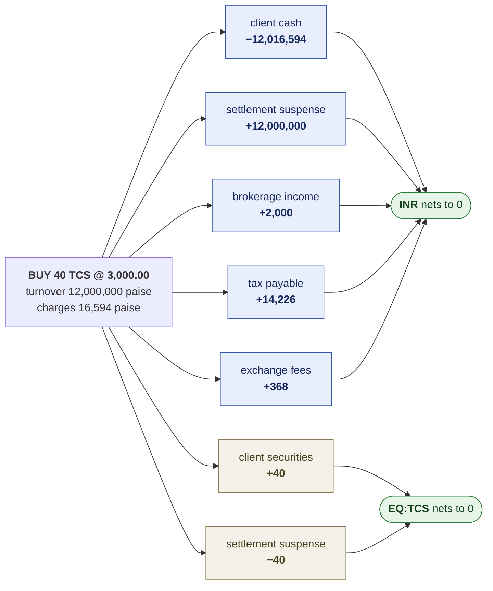
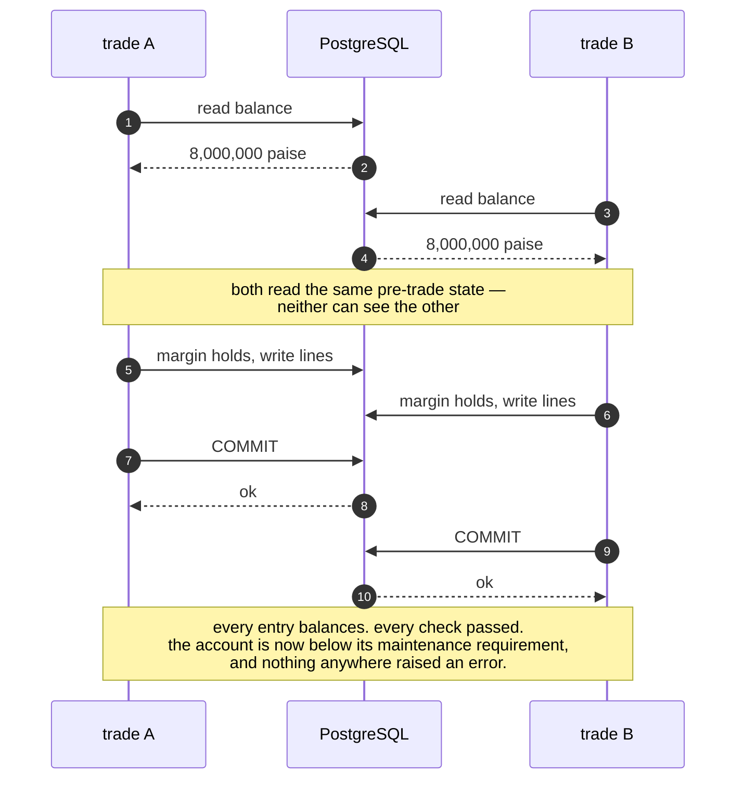
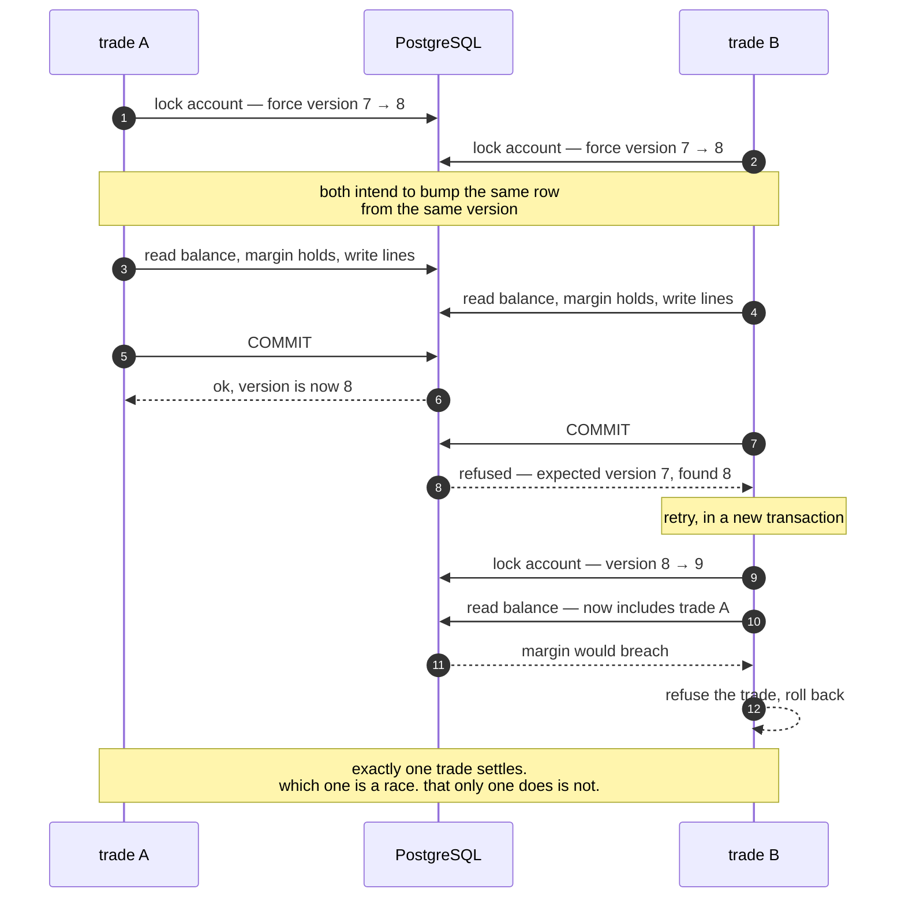
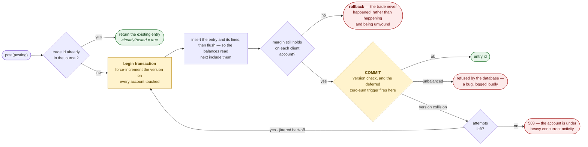
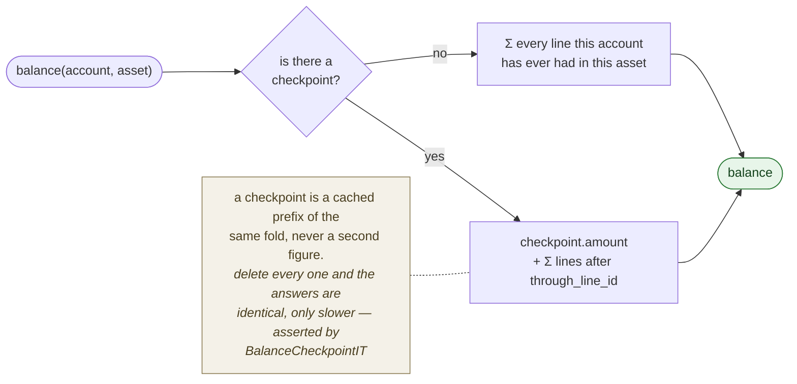
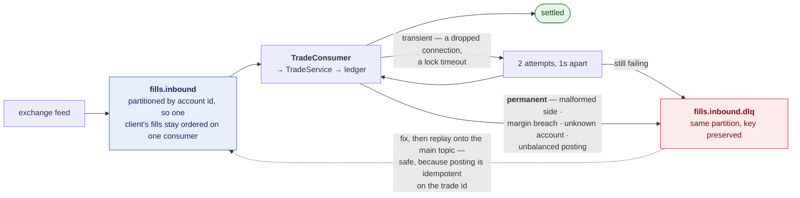

# Architecture

How clearbook is put together, and why. The [README](../README.md) says what it
does; this says how, what it refuses to do, and what was traded away.

Figures throughout come from the reference scenario in
[`docs/examples.md`](examples.md), which is generated by running the domain
code rather than written by hand.

---

## The shape of it

Three layers, and the boundaries between them are deliberate.

**The domain is plain Java.** `Money`, `FeeSchedule`, `TradePostings` and
`MarginPolicy` have no Spring annotations and no database access. The
arithmetic they carry is the part most worth testing, and it tests far better
as a value object you can construct in one line than as a bean that needs an
application context to exist. `LedgerConfiguration` is the only place the two
worlds meet.

**`LedgerService` and `LedgerWriter` are separate beans**, which looks like
over-engineering until you try to merge them. A retry has to wrap the
transaction, not sit inside it: once a transaction has failed its version
check it is marked rollback-only and nothing can be salvaged from within it.
Spring applies `@Transactional` through a proxy, and a call from one method of
a bean to another on the same bean does not pass through that proxy — so
"retry method calls transactional method" only works when they are different
beans.

**The read side folds the journal.** `BalanceService` and `StatementService`
never read a stored balance, because there isn't one.

---

## An entry balances per asset

A trade moves rupees and shares in the same instant, and those cannot be
summed into anything meaningful. So the zero-sum rule is scoped to
`(entry, asset)`:

Enforced by a `DEFERRABLE INITIALLY DEFERRED` constraint trigger, so it fires
at COMMIT against the finished entry rather than part-way through inserting
its lines — and so that no code path can bypass it, including one nobody has
written yet.

The domain checks the same rule in `Posting`'s constructor. That is not
redundancy for its own sake: the database check is the one that cannot be
bypassed, and the domain check is the one that produces a diagnosable error
naming the asset and the amount, at the point the lines were built, rather
than a constraint violation at flush time.

Note what the entry does **not** do: it never moves cash directly between two
client accounts. Settlement suspense sits in the middle of both legs, because
a clearing system never has one client's money become another's without the
clearing house in between — and modelling it that way makes an unsettled
obligation a visible balance rather than an absence.

---

## The race this exists to survive

Two trades arrive for the same account at the same moment. Each is
individually correct, and run one at a time nothing here can fail.

### Without the lock

This is **write skew**. The ledger balances perfectly. Every entry is valid.
Every margin check passed. The account is below its maintenance requirement
and nothing anywhere raised an error, so it will be found in a reconciliation
rather than in a log.

No amount of per-trade validation finds this, because each trade *was* valid
when it was checked. The only fix is to make the two transactions conflict.

### With it

Every posting takes an `OPTIMISTIC_FORCE_INCREMENT` on each account it
touches. The second transaction fails its version check, retries in a new
transaction, re-reads the balance, and this time sees the first trade.

The force-increment has to be explicit. The account row carries no balance —
there is nothing on it to dirty — so without an explicit lock Hibernate would
see a clean entity, write nothing, and the two transactions would never
collide at all.

`ConcurrentSettlementIT.writeSkewCannotBreachMargin` releases both trades from
a latch and asserts exactly one survives. Which one is a race; that only one
does is not.

---

## A posting, end to end

Two details in that flow are easy to get wrong.

**The flush before the margin check.** The balances read for margin must
include the lines just written, or the check is answering a question about the
state before the trade. The deferred zero-sum trigger still fires at COMMIT —
the flush only makes the rows visible to this transaction's own queries.

**Margin breach rolls back rather than compensating.** The check runs before
the commit, so a refused trade never happened. Posting it and then reversing
it would leave two entries on the client's statement describing something that
was never true.

---

## Balances are derived

There is no `balance` column anywhere in the schema. Storing one means
maintaining two representations of the same fact, and the day they disagree is
the day nobody can say which is right. Deriving it means a statement and the
balance it closes on cannot disagree — the movements *are* the balance.

The cost is that the naive version is O(history) on the critical path of every
margin check, which is what `balance_checkpoint` addresses. It is carefully
not a second source of truth: it caches a prefix of the same fold.
`BalanceCheckpointIT` deletes every checkpoint mid-test and requires every
answer to be identical.

**Why checkpointing on a line id is safe here when in general it is not.**
Identity values are assigned before commit, so two concurrent writers can
commit out of order: line 101 becomes visible, a checkpoint is taken "through
101", and line 100 commits afterwards — permanently invisible to every future
balance. That bug is real, and it is avoided only because every posting bumps
`account.version`, so postings to a single account cannot commit concurrently.
Line ids are therefore gap-free in commit order *per account*, which is
exactly the scope a checkpoint covers.

Remove the version bump and this table silently starts losing money. The two
mechanisms are load-bearing together, not independently.

---

## Ingestion

**Redelivery is not prevented, it is made harmless.** Kafka is at-least-once:
a consumer that processes a record and dies before its offset commits will see
it again, and no amount of care avoids that. So the work itself is idempotent
— `journal_entry.trade_id` carries a UNIQUE constraint, and a second delivery
finds the entry already there.

That constraint, rather than an application-level "have I seen this?" check,
is the guarantee. The check is still worth doing, because it turns the common
case into one cheap read instead of a failed insert — but every concurrent
caller can pass it before any of them inserts, which is precisely what
redelivery produces. `ConcurrentSettlementIT.concurrentRedeliveryPostsOnce`
fires the same trade from twenty threads and asserts one entry and one charge.

**Permanent failures skip the retries.** Retrying a malformed record is not
merely wasteful: the consumer stops making progress on that partition while it
does, so one bad message stalls every good message behind it. That is how a
single poison record takes a settlement system down.

---

## Testing

| tier | needs | what it establishes |
|---|---|---|
| `mvn test` | a JDK | the arithmetic: money, fees, rounding, posting invariants |
| `mvn verify` | Docker | the database's invariants, the race, idempotency, the API, Kafka |
| `./tools/verify-schema.sh` | a PostgreSQL | the DDL alone, with no Java involved |
| `./tools/demo-ledger.sh` | a PostgreSQL | the reference scenario, end to end in SQL |

The split matters. The properties under test in the second tier are properties
of PostgreSQL specifically — a deferred constraint trigger, a UNIQUE index
closing a race, two transactions genuinely colliding on a version check. H2
implements none of them and a mock implements fewer, so a suite built on
either would pass while production refused every posting. But requiring Docker
to run *any* test would mean nobody can check the arithmetic on a laptop
without it.

The bottom two tiers exist because the ledger's claims are claims about the
schema. Being able to demonstrate them with `psql` and nothing else is the
clearest possible statement that the database is doing the work rather than
the Java in front of it.

---

## What was traded away

- **Equity cash segment, single currency, T+1 only.** No derivatives, no FX,
  no multi-currency netting.
- **Flat maintenance margin**, not SPAN or portfolio margin. Netting
  offsetting risk across a portfolio is right for a real clearing member and
  would be most of the project; it would also do nothing about the race, which
  is where the interesting failure actually lives.
- **No settlement cycle yet.** Positions land in suspense and stay there. The
  T+1 job that moves them to settled is the next piece, and the suspense
  balance in the demo output is exactly the obligation it would clear.
- **No corporate actions.** Dividends and splits are large and orthogonal.
- **Pro-rata block allocation is unimplemented**, which is why
  `ROUNDING_RESIDUE` exists as an account kind and never receives a posting.
  Allocating one fill across several client accounts is the case that
  genuinely produces a residue; charging a single client does not, because the
  total is defined as the sum of the rounded components.
- **No row-level security.** Any caller can request any client's statement.
- **One PostgreSQL, no sharding**, and mark prices are loaded rather than
  streamed.
